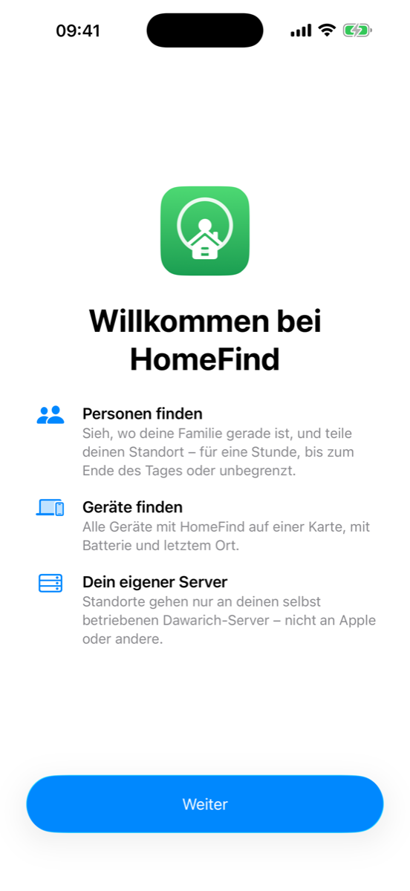
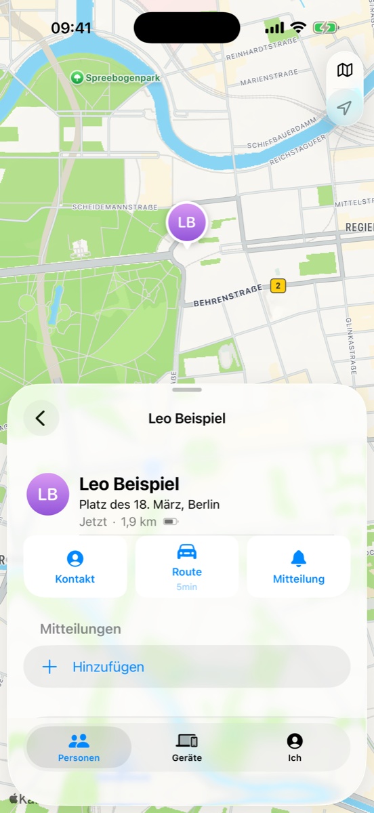
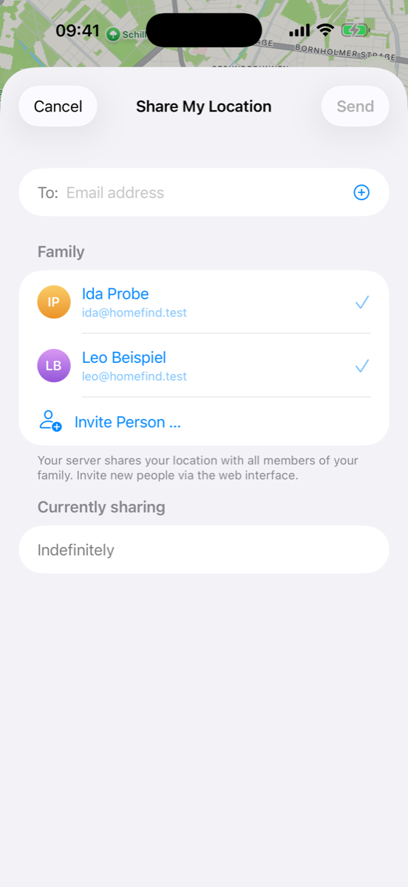
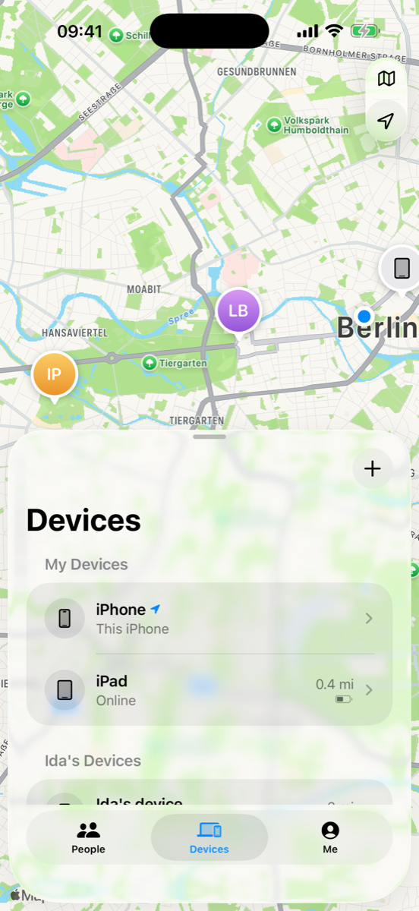
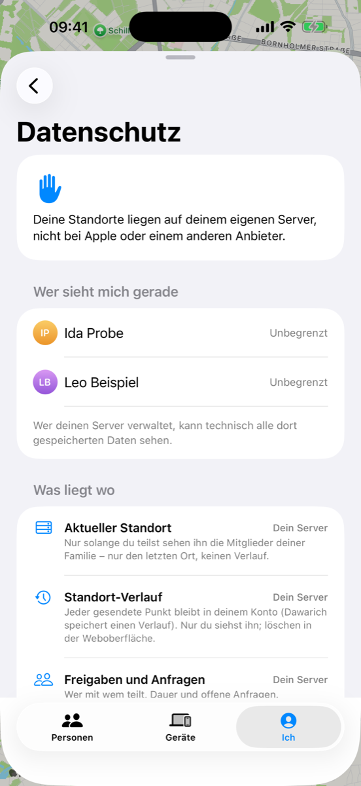

# HomeFind

**A native iOS "Find My" for your own [Dawarich](https://dawarich.app) server – the look and feel of Apple's Find My app, without iCloud.**

HomeFind is an independent iPhone client for a self-hosted Dawarich server. It aims to feel like Find My on iOS 26 (full-screen map, Liquid Glass card in three sizes, People · Devices · Me) while every location stays on hardware you own.

> **Status:** first version, tested in the simulator against Dawarich **1.22.0** with three test accounts and simulated locations (34 automated tests: API client against the server, sharing logic, and one UI test per main action – share 1 h/end of day/indefinitely, request, accept, decline, alerts, region monitoring with a simulated arrival, devices, privacy, map). UI in **English and German** (follows the iPhone language). Code comments are in German.
>
> Built with help from [Claude Code](https://claude.com/claude-code): Apple's Find My was analysed by names and texts only (no decompiling, no Apple code), the Swift was written together with it.
>
> **Personal project:** no guarantees, no support promises. Bug reports and pull requests are welcome.
>
> Not affiliated with Apple or with Dawarich. "Find My" is a trademark of Apple Inc.; "Dawarich" belongs to its owners.

<p align="center">
  
  
  
  
  
</p>
<p align="center"><sub>Screenshots with demo accounts and made-up positions.</sub></p>

## Features

**Map**
- Full-screen map with people and your own devices, clustering when zoomed out, your own position as the blue dot
- Map modes Standard / Hybrid / Satellite, traffic, distance in kilometers or miles, compass, 2D/3D, "My Location" button
- Info card in three sizes over the map (small, half, full) – the map stays usable behind it
- Hardware keyboard: ⌘+ / ⌘− zoom, ⌘1/⌘2/⌘3 switch tabs

**People**
- Sections *Notifications* (open requests, "share back?"), *Favorites* and everyone else
- Place name, "Now / 5 min. ago", distance, battery; "With You", "Can see your location", "Request sent"
- Detail card: Contact (contact card without address-book access), Directions with travel time, Notify
- **Share My Location for one hour, until the end of the day, or indefinitely**, with remaining time ("2 hours left")
- **Ask to follow location**, **accept / decline** requests (also right from the notification), **stop sharing**
- Favorites, remove (via the server's family management)

**Devices**
- Every device with HomeFind (iPhone, iPad) with battery, place and last update
- Name + emoji, details (model, system, app version), "use as My Location", remove device
- Family members' devices (the device they share from)
- Add another own device by scanning a QR code

**Me**
- My location with place name and the device it comes from
- Main switch *Share My Location* with remaining time
- **Location names** (Home, Work, School, Gym, custom) – stored as places on your server
- **Location alerts**: "notify me when Leo arrives at / leaves …" and "when I arrive / leave …" – once or every time, small/medium/large radius, place from the current position, your places or address search
- Battery-friendly background sending (on/off), distance unit, notification settings
- **Privacy page**: who can see me right now, what is stored where, which Apple services are involved, switch for Apple place-name lookups

**Under the hood**
- Sends points in OwnTracks format; offline buffer (survives restarts)
- Foreground: at most once a minute or after 50 m. Background: only *significant location changes* (~500 m) and *visits* – no continuous GPS
- Alerts about yourself use region monitoring (`CLMonitor`, max. 20 regions) and report arrivals/departures to Dawarich (`/points/transitions`); alerts about others are evaluated on your iPhone whenever the shared location is fetched
- No push (needs a paid developer account): polling while open, background refresh and location wake-ups otherwise; local notifications for new requests, "X is now sharing with you", arrivals/departures and the end of your sharing period
- "Until end of day": Dawarich only knows whole hours, so the app rounds up and switches sharing off itself at midnight

**Not possible without Apple** (and therefore not included): AirTags/Items, the Find My network, Lost Mode, remote lock/erase, Activation Lock, play sound on devices without the app, precision finding, satellite.

## Requirements

- A Dawarich server (tested with **1.22.0**, needs the Family API from 1.13.1) reachable from the iPhones – at home or via VPN/HTTPS
- Xcode 26, [XcodeGen](https://github.com/yonaskolb/XcodeGen) (`brew install xcodegen`)
- iPhone with iOS 26

## Install without a Mac

You need your own Dawarich server for this. **Step-by-step guide (server with Docker, accounts, family, install, sign-in): [docs/SETUP.md](docs/SETUP.md).**

1. Download `HomeFind-<version>.ipa` from the latest release.
2. Install it with [SideStore](https://sidestore.io) or [AltStore](https://altstore.io). A free Apple ID is enough, the app then has to be refreshed every 7 days (SideStore does that on the phone).
3. Open the app and sign in with your server address and your Dawarich account (or API key).

## Build & install

```bash
git clone https://github.com/<you>/homefind.git
cd homefind
xcodegen generate
open HomeFind.xcodeproj
```

1. Set your own **bundle identifier** in `project.yml` (default `org.homeroll.homefind`) and select your team in Xcode.
2. Run on your iPhone and sign in with your server address (e.g. `https://find.example.com` or `http://192.168.x.y:3000`).
3. Unsigned IPA for sideloading (AltStore/SideStore): `./build-ipa.sh`.

### Simulator with test accounts

Test credentials live in an env file outside the repo (never commit it):

```bash
# FIND_SERVER, FIND_MIA_KEY, … (see tools/demo-state.sh)
FIND_ENV=~/path/to/test-accounts.env tools/demo-state.sh all   # demo positions for the other accounts
FIND_ENV=~/path/to/test-accounts.env ./sim-run.sh              # build, install, launch signed in
FIND_ENV=~/path/to/test-accounts.env tools/run-tests.sh        # unit + UI tests against the test server
```

Debug builds read `FIND_SERVER` / `FIND_TOKEN` (sign in without typing) and `FIND_SKIP_ONBOARDING=1`. Release builds ignore them. Locations in the simulator are simulated with `xcrun simctl location <udid> set|start`, never real ones.

Strings: German keys with English translations; after adding texts run a build and `python3 tools/strings.py` (translations in `tools/en.json`).

## Privacy

- The app talks **only** to your Dawarich server – plus Apple Maps for map tiles, directions/travel time and (switchable) place names.
- No analytics, no third-party SDKs, no push service.
- API key in the Keychain (this device only); the password is used once to get the key and never stored.
- Family members only ever see your latest location while you share; HomeFind never enables Dawarich's history sharing. Your own history stays in your account and can be deleted in the web interface.
- Location alerts, favorites and settings stay on the device.

## Project layout

```
App/Core/     API client, session, location service, alerts/regions, app model
App/UI/       SwiftUI views (map, people, devices, me, alerts, onboarding)
Resources/    string catalogs, assets
Tests/        unit tests (API client against a test server, logic)
UITests/      UI tests per action
tools/        icon generator, strings, demo state, test runner
```

## License

[MIT](LICENSE). Third-party: Dawarich (AGPL-3.0) is not included – HomeFind only talks to its HTTP API.

---

<!-- home-apps:start -->
## More Home apps

Same idea, other Apple apps – all free, open source and self-hosted:

- **[HomeRoll](https://github.com/silentprovider423/HomeRoll)** – Photos · Immich
- **[HomeRoll Desktop](https://github.com/silentprovider423/HomeRoll-Desk)** – Photos for Mac · Immich
- **[HomeRoll TV](https://github.com/silentprovider423/HomeRoll-TV)** – Photos for Apple TV · Immich
- **[HomeTune](https://github.com/silentprovider423/HomeTune)** – Music · Navidrome
- **[HomeNotes](https://github.com/silentprovider423/HomeNotes)** – Notes · Nextcloud
- **[HomePost](https://github.com/silentprovider423/HomePost)** – Mail · IMAP/SMTP or JMAP
- **[HomeCast](https://github.com/silentprovider423/HomeCast)** – Podcasts · PinePods
- **[HomeThread](https://github.com/silentprovider423/HomeThread)** – notes to self · own server (Docker)

All apps: [github.com/silentprovider423](https://github.com/silentprovider423)
<!-- home-apps:end -->

## Deutsch

**HomeFind** ist eine eigene „Wo ist?“-App fürs iPhone, die Standorte über deinen selbst betriebenen Dawarich-Server teilt statt über Apple. Sie sieht aus und bedient sich wie „Wo ist?“ unter iOS 26 (Personen, Geräte, Ich), aber alle Standorte bleiben auf deiner eigenen Hardware. Die Oberfläche gibt es auf Deutsch und Englisch, je nach Sprache des iPhones. Funktionen, Voraussetzungen und Installation stehen oben.
